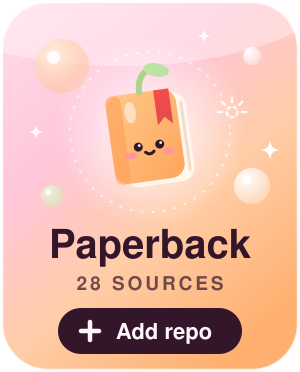
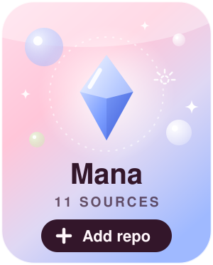
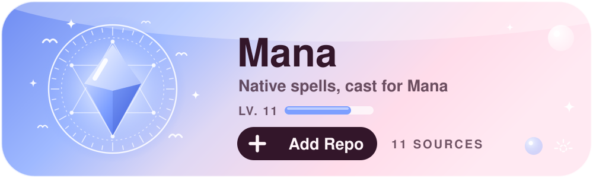
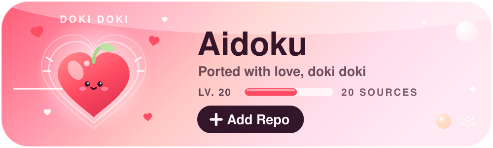

<p align="center">
  
</p>

<p align="center">
  
  
  <br/>
  
  
</p>

<p align="center">
  <a href="https://poppingmangosources.github.io/general-extensions-mangago/0.9/test/"></a>
  <a href="https://poppingmangosources.github.io/popmango-extensions-mana/"></a>
  <a href="https://poppingmangosources.github.io/popmango-aidoku-sources/"></a>
</p>

---

## About

Hi, I'm **Popmango**. I build and maintain source lists for iPhone and iPad readers, covering
novels, manga, manhwa, and manhua. Every extension is made in my own repositories, none of them
are mirrors of anyone else's catalog.

- **[Paperback](https://paperback.moe)**, an ad-free reader, gets my main list.
- **[Mana](https://mana-ios.github.io)** gets its own sources, written directly against the Mana extension API rather than
  repackaged from another app, so home sections, filters and settings behave the way Mana expects.
- **[Aidoku](https://aidoku.app)** gets ports of my Paperback sources, so the same titles are readable there. They work,
  but fixes land whenever I get to them.

## My Repositories

| Repository                                                                                  | What it is                                                                                      |
| :------------------------------------------------------------------------------------------ | :---------------------------------------------------------------------------------------------- |
| **[Paperback Sources](https://github.com/PoppingMangoSources/general-extensions-mangago)** | The main list. 28 extensions for Paperback 0.9: 23 manga, manhwa & manhua, and 5 novel sources. |
| **[Mana Sources](https://github.com/PoppingMangoSources/popmango-extensions-mana)**        | 11 sources written natively for Mana, including MangaDex, MangaFire, Mangago and MangaUpdates.  |
| **[Aidoku Sources](https://github.com/PoppingMangoSources/popmango-aidoku-sources)**       | 20 sources ported from the Paperback code. Fixes land whenever I get to them.                   |

<details>
<summary><b>Every Source, By App</b></summary>
<br/>

<p align="center">
   <b>Paperback</b> &nbsp;·&nbsp;  <b>Mana</b> &nbsp;·&nbsp;  <b>Aidoku</b>
</p>

#### Manga, Manhwa &amp; Manhua · 28

| Source | Apps |
| :----- | :--- |
| &nbsp; **BunManga** |   |
| &nbsp; **Chikari** |   |
| &nbsp; **Cocomic** |   |
| &nbsp; **FlameComics** |  |
| &nbsp; **KingOfShojo** |   |
| &nbsp; **LikeManga** |   |
| &nbsp; **Lua Comic** |  |
| &nbsp; **MangaBerri** |   |
| &nbsp; **MangaCherri** |   |
| &nbsp; **MangaDex** |  |
| &nbsp; **MangaFire** |  |
| &nbsp; **Mangago** |  |
| &nbsp; **MangaHere** |  |
| &nbsp; **MangaHome** |   |
| &nbsp; **MangaTown** |   |
| &nbsp; **Mkissa** |  |
| &nbsp; **MyReadingManga** |  |
| &nbsp; **ReiManga** |   |
| &nbsp; **RinkoComics** |    |
| &nbsp; **RokariComics** |    |
| &nbsp; **Scans.GG** |   |
| &nbsp; **StoneScape** |   |
| &nbsp; **Temple Scan** |   |
| &nbsp; **Toonkotsu** |   |
| &nbsp; **ValirScans** |    |
| &nbsp; **VyManga** |   |
| &nbsp; **XCOMIC** |   |
| &nbsp; **YaoiMe** |  |

#### Novels · 5

| Source | Apps |
| :----- | :--- |
| &nbsp; **MVLEMPYR** |   |
| &nbsp; **NovelArchive** |   |
| &nbsp; **NovelCool** |   |
| &nbsp; **Ranobes** |  |
| &nbsp; **VioletScans** |  |

#### Tracking · 1

| Source | Apps |
| :----- | :--- |
| &nbsp; **MangaUpdates** |  |

</details>

## Add a Repository

### Paperback

<p align="center">
  <a href="https://poppingmangosources.github.io/general-extensions-mangago/0.9/test/"></a>
</p>

On iPhone or iPad, tap the button and add the repository from the page that opens. To add it by
hand, open Paperback and go to **Settings → Extensions → Add Repository**, then paste:

```
https://poppingmangosources.github.io/general-extensions-mangago/0.9/test/
```

### Mana

<p align="center">
  <a href="https://poppingmangosources.github.io/popmango-extensions-mana/"></a>
</p>

Tap the button, then **Add to Mana** on the page it opens. To add it by hand, open Mana and go to
**Discover → Repositories → Add Repo**, then paste:

```
https://poppingmangosources.github.io/popmango-extensions-mana/main
```

### Aidoku

<p align="center">
  <a href="https://poppingmangosources.github.io/popmango-aidoku-sources/"></a>
</p>

Tap the button and choose **Add Repository** on the page that opens. To add it by hand, open
Aidoku and go to **Settings → Source Lists**, then paste:

```
https://poppingmangosources.github.io/popmango-aidoku-sources/index.min.json
```

Refresh the repository in any of the apps whenever you want to pick up source updates.

## Support

<p align="center">
  <a href="https://discord.com/invite/inkdex">
    
  </a>
</p>

<p align="center">
  <a href="https://discord.com/channels/965890377896845352/1367512880228077648">
    
  </a>
</p>

**A broken Paperback source**: report it in the [**OTHER-REPOS**](https://discord.com/channels/965890377896845352/1367512880228077648) channel of the
linked Discord, where the PoppingMango support chat lives. Issues on the Paperback repository are
not the place for these.

**A broken Mana source**: open an
[issue](https://github.com/PoppingMangoSources/popmango-extensions-mana/issues) on that repository
with the bug report form. The source version Mana shows next to the extension helps most.

**A broken Aidoku source**: open an
[issue](https://github.com/PoppingMangoSources/popmango-aidoku-sources/issues) on that repository.
Fixes land whenever I get to them.

**A new source you'd like added**: open an
[issue](https://github.com/PoppingMangoSources/general-extensions-mangago/issues) on the Paperback
repository under the **source request** label, or use the source request form on the Mana
repository. Requests only, and no promises about which ones get built.

Wherever it goes, include the affected source, the page or title that failed, and screenshots or
request details when possible, it makes fixes much faster.

## Disclaimer

These extensions are not affiliated with Paperback, Mana, Aidoku, or any of the websites they read
from, and none of those parties endorse this work. No content is hosted here; the extensions only
read publicly available pages. All site names and logos belong to their respective owners.
